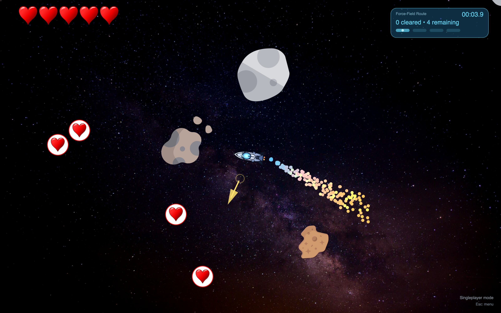
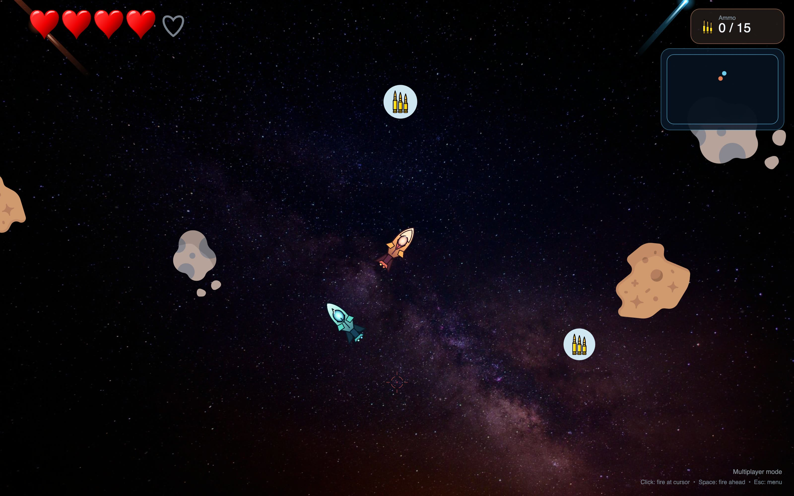
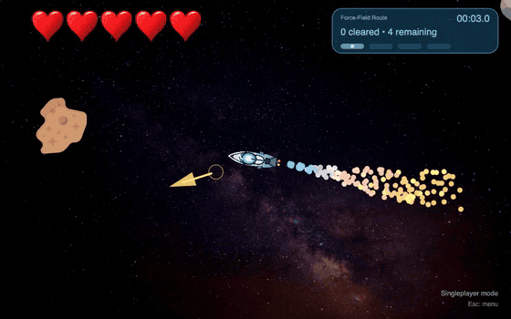

# Asteroids

[](https://github.com/trebeljahr/asteroid-game/actions/workflows/build-and-deploy.yml)
[](LICENSE)

Fly a small ship through an asteroid field, right in your browser. Race a route of four force fields against the clock, or take on other people: one opponent in a duel, or up to 19 in a battle royale.

On a computer you steer with the keyboard. On a phone you turn it sideways and use the touch buttons, in the same matches as everyone else. Nothing to install, and no account to make.

Play at **[asteroids.trebeljahr.com](https://asteroids.trebeljahr.com)**.



## What's in the game

- **Three modes.** A singleplayer run through four force fields, timed to the tenth of a second. A 1v1 duel that pairs you with the next player in the queue. A battle royale lobby for up to 20 ships in a larger arena.
- **Six ships.** Each has its own collision outline, traced from its drawing, so a hit lands where you see it.
- **Pickups.** In a match you start without ammo. Collect it from the field, and collect hearts to heal.
- In a match, fire straight ahead with Space or click to fire at the cursor. On a phone, a stick on the right aims and fires.
- **Matches survive server updates.** When the game server restarts for a deploy, another server takes over the running match. A player who drops out keeps their seat for 30 seconds.
- **20 achievements** and your run and match stats, kept per device.
- Sound effects and music are generated in the browser. Options has a switch for them.
- You can install the game as an app (PWA) from the browser.





## How multiplayer works

The server owns the game state and steps the world 60 times a second. It sends each player a snapshot every second step. Your browser moves your own ship at once from your input and corrects it when the snapshot arrives, so steering feels direct on a slow connection too. [docs/multiplayer-netcode.md](docs/multiplayer-netcode.md) explains the design, and [docs/rolling-handoff.md](docs/rolling-handoff.md) how a match moves to another server during a deploy.

## Run it locally

You need Node.js 24 or newer and pnpm 10. Docker is optional.

```bash
pnpm install
pnpm dev          # client and server on random ports
pnpm dev:fixed    # client on 5173, server on 9777
pnpm dev:lan      # fixed ports, open to your LAN (for phone testing)
pnpm dev:no-deps  # skip Docker; use DATABASE_URL / REDIS_URL if you set them
pnpm dev:down     # stop the Docker dev dependencies
```

`pnpm dev` starts Postgres and Redis with Docker when it can. Without them the game still runs: accounts, stats and achievements are off, and matches stay in one server process.

Debug tools (collision outlines, netcode overlay) only exist in dev builds. Open the dev URL with `?debug=1` to show their toggles in Options; the choice is remembered until `?debug=0`.

Checks:

```bash
pnpm check        # TypeScript in shared, client and server
pnpm test:server
pnpm test:client
```

```bash
# The whole stack in local Docker
docker compose up
```

## Deployment

The web client is a static Vite build on a Cloudflare Worker. The game server is a Docker image on Coolify, and Redis lets several server replicas share rooms. Every push to `main` runs [`build-and-deploy.yml`](.github/workflows/build-and-deploy.yml). Routing, the release order and error reporting are in [docs/deployment.md](docs/deployment.md).

Error reports carry no user id, device token, cookie or IP address. The [privacy page](https://asteroids.trebeljahr.com/privacy) lists what they do carry.

## Project structure

```
client/          React + Vite frontend
  src/           game loop, rendering, input, menus
  public/        images, icons, privacy and imprint pages
  server.mjs     static file server with backend proxy, used by docker compose
server/          Express + Socket.IO + tRPC backend
  src/           matchmaking, multiplayer rooms, accounts, Postgres, Redis
shared/          types and game logic used by client and server
scripts/         dev runner, handoff proof, marketing captures
docs/            netcode, rolling handoff, deployment, marketing assets
```

## Tech stack

TypeScript throughout. The client uses React for menus, p5.js for the canvas and Matter.js for singleplayer physics. The server runs Express, Socket.IO and tRPC on Node.js 24, with Postgres (Drizzle ORM) for accounts and achievements and Redis as the Socket.IO adapter. GitHub Actions builds and deploys both halves.

## License and credits

The code is licensed under the [GNU Affero General Public License v3.0 or later](LICENSE). If you run a changed version for other people over a network, you must offer them its source. The game's sounds and music are generated by that code, so the same licence covers them.

These files are not covered by the AGPL:

- **Asteroid and ammo icons** (`client/public/assets/asteroid1–3`, `bullets`): by [Freepik](https://www.flaticon.com/authors/freepik) and [Smashicons](https://www.flaticon.com/authors/smashicons) from [Flaticon](https://www.flaticon.com/), under the Flaticon free licence, which asks for this credit. The game's Credits screen gives it too.
- **Heart** (`client/public/assets/heart.svg`, `heart.png`): from [Openclipart](https://openclipart.org), released into the public domain.
- **Rocket** (`client/public/assets/rocket.svg`, `rocket.png`, not used by the game): image 297573 from [Pixabay](https://pixabay.com), under the Pixabay Content License.
- **Background photo** (`client/public/assets/background.jpg`, the night sky behind the game): its source is not recorded, so no licence is offered for it here.
- **Images made for this project** (the six ships in `client/public/assets/alternatives/`, the favicons, app icons and preview images such as `og-image.png` and `null-vector-thumbnail.svg`, and the screenshots and cards in `docs/marketing/`): © Rico Trebeljahr, all rights reserved. Third-party art inside them keeps its own terms.

No fonts are bundled. The game uses the fonts on your system.

## Support

Asteroids is free and shows no ads. To support it and Rico's other free projects: [ricos.site/donate](https://ricos.site/donate).
